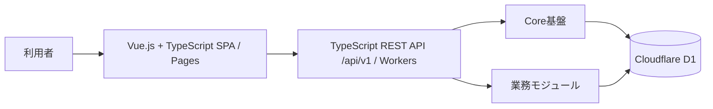

# システム概要設計書

- 設計ID: SYS-BD-001
- 対応プロジェクト設計: SYS-OV-001

## 1. 目的
中小企業向けに、社員・組織、報告、承認、申請、通知、ファイル、監査を共通基盤から利用できる社内業務管理プラットフォームを提供する。

## 2. 設計方針
- 業種固有ルールを業務モジュール外に閉じ込める。
- モジュラモノリスを採用し、初期段階のマイクロサービス化は行わない。
- テナントごとの組織構造、ワークフロー、契約機能を設定可能にする。
- 初期公開先をCloudflare Pages、Workers、D1とし、環境依存処理はアダプターで分離する。
- Cloud/On-premises対応方針は維持するが、Cloudflare以外の実行環境・DBアダプターは未決定とする。

## 3. 機能概要
共通基盤はテナント、ユーザー、認証、権限、通知、ファイル、操作ログ、監査、ダッシュボード、モジュール、契約プランを扱う。初期業務候補は社員、組織、報告、ワークフローとし、休暇申請、Wiki、タスク等は将来モジュールとする。

## 4. 想定利用者・ユースケース
- テナント管理者: テナント、組織、権限、フロー、契約モジュールを管理。
- 一般社員: 報告・申請・承認・通知・ファイルを利用。
- 承認者: 内容確認、承認、否認、差戻し、代理承認を実施。
- 運用者: 障害監視、バックアップ、監査確認を実施。

## 5. 処理概要
ブラウザはREST API経由でBackendへ要求し、認証・テナント・権限を検証する。Application Serviceがユースケースを実行し、Domainが業務ルール、Repositoryが永続化境界を担う。

## 6. データの流れ
テナント情報、認証主体、要求操作はリクエストコンテキストとして伝播する。業務データは原則tenant_idで分離し、監査対象操作は監査イベントへ記録する。

## 7. 関連モニタ・テーブル・API
- 関連モジュール: Core、Employee、Organization、Report、Workflow
- 関連テーブル: テナント、ユーザー、ロール、権限、監査ログ、通知（詳細は設計分割後に確定）
- 関連API: `/api/v1/*`（詳細はA-IDへ対応付け）

## 8. セキュリティ考慮事項
認証、テナント境界、権限、入力検証、CSRF、XSS、SQLインジェクション、アップロード、個人情報、監査ログへのアクセス制御をAPI側で強制する。

## 9. 将来拡張への考慮
モジュールレジストリ、公開インターフェース、契約可否判定、イベント、外部連携アダプターを介して休暇申請、Wiki、タスク、AI等を追加する。

## 10. 未決定事項
- 認証方式・セッション方式・トークン方式
- テナント識別方法
- TypeScript、Vue.js、Workers互換性の具体バージョン
- Workers APIのフレームワーク、D1のアクセス方式
- Cloudflare以外の実行環境・DBアダプターとオンプレミス対応方法
- 個人情報項目、保持期間、マスキング方式
