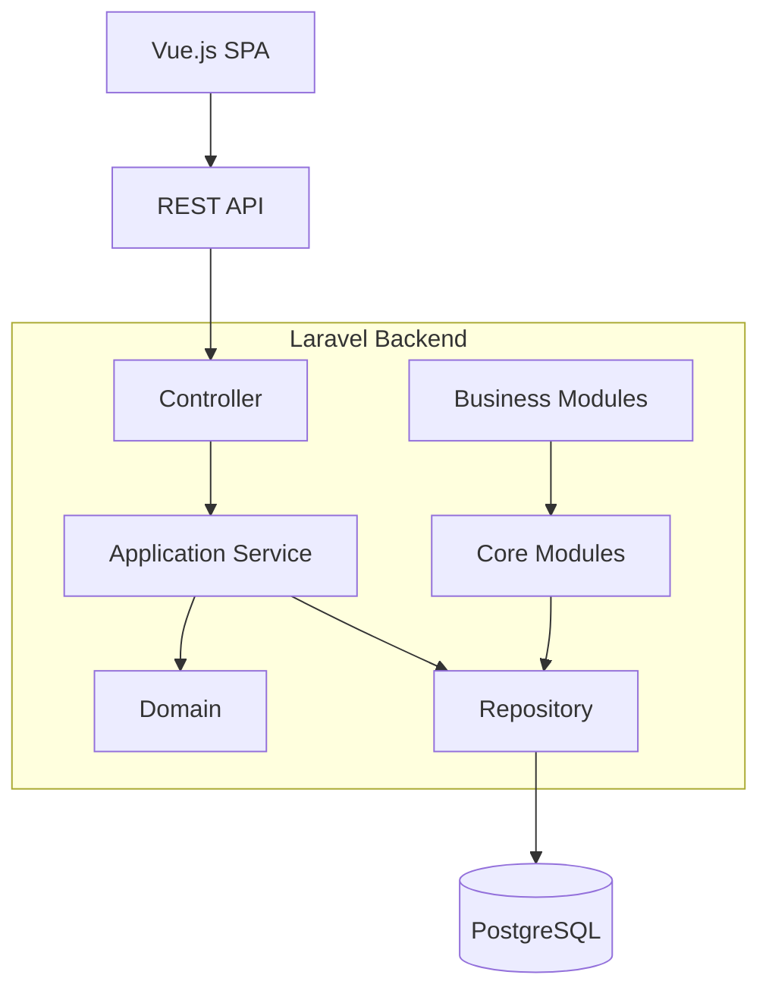

# システムアーキテクチャ設計書

- 設計ID: SYS-BD-002

## 1. 目的
実装・保守・将来拡張時に、責務境界と環境依存箇所を明確にする。

## 2. 設計方針
- モジュラモノリスを採用。
- Core、Modules、Infrastructure、Frontendの依存方向を限定。
- 内部モジュール参照は公開ユースケースまたはドメインイベント経由。
- 環境依存処理はインターフェースとアダプターで分離。

## 3. 機能概要
BackendはHTTP受付、ユースケース、ドメイン、永続化境界、外部連携を単一デプロイユニット内に配置する。Frontendは共通Core UIと業務モジュールUIへ分割する。

## 4. 処理概要
Controllerは入力受付とレスポンス変換、Application Serviceはユースケース、Domainは業務ルール、Repositoryは永続化を担う。システム例外は共通ハンドラーが安全なレスポンスへ変換する。

## 5. データの流れ
HTTPリクエストは認証・テナント・権限フィルターを通過し、テナントスコープ付きコンテキストへ変換される。永続化前にDomainルールを検証し、監査イベントを同一トランザクションまたは確実な配信経路で記録する。

## 6. 関連モジュール
- Core: Tenant、Auth、Permission、Notification、File、Audit
- Modules: Employee、Organization、Report、Workflow
- Infrastructure: DB、Storage、Mail、ExternalAuth、AI

## 7. 関連テーブル・API
テーブル構成はSYS-BD-004、API規約はSYS-BD-008を参照する。アダプター固有テーブルは詳細設計時に確定する。

## 8. セキュリティ考慮事項
各境界でテナント、権限、入力検証を実施し、秘密情報をログへ出力しない。外部接続情報は環境変数またはシークレットストアを使用する。

## 9. 将来拡張への考慮
モジュールレジストリ、公開ユースケース、契約プラン判定、イベント、アダプター切替により機能追加を可能にする。マイクロサービス化は暫定的に行わない。

## 10. 未決定事項
- モジュールディレクトリ名の最終構成
- イベントバス方式
- AI処理基盤の同期・非同期方式
- バックエンドとFrontendのデプロイ方式
