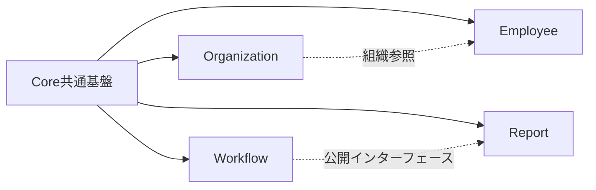

# モジュール設計書

- 設計ID: SYS-BD-003

## 1. 目的
業務機能の責務境界、モジュール間依存、将来追加方法を定義する。

## 2. 設計方針
- Coreと業務Moduleを分離。
- 業務モジュール間の直接参照を禁止し、公開インターフェースまたはイベントを使用。
- モジュール契約は契約プランと連動可能にする。
- 将来モジュールが既存モジュールを大幅変更せず追加できる構成とする。

## 3. 機能概要
|モジュール|責務|状態|
|---|---|---|
|Core|テナント、認証、権限、通知、ファイル、監査、契約、モジュール管理|基本設計対象|
|Employee|社員情報、所属、上司、兼務、代理承認者候補|初期候補|
|Organization|部署、役職、組織階層、変更履歴|初期候補|
|Report|報告種別、テンプレート、提出、差戻し、集計|初期候補|
|Workflow|定義、ノード、承認者、分岐、履歴、バージョン|初期候補|
|Future|休暇、Wiki、タスク、案件、教育、評価、掲示板、議事録、AI|将来追加|

## 4. 処理概要
モジュールは公開ユースケース、イベント契約、読み取りモデルのいずれかで連携する。契約未加入モジュールはルーティングとAPIで利用不可とし、サーバー側で契約判定を行う。

## 5. データの流れ
各業務データはtenant_idとモジュールデータを保持する。モジュール間で参照が必要な場合、外部キーの直接共有ではなく公開IDまたは公開契約により参照する。

## 6. 関連テーブル
- T-MODULE
- T-MODULE_PLAN
- T-TENANT_MODULE（テーブルIDは詳細設計時確定）
各業務モジュール固有テーブルは機能詳細設計で定義する。

## 7. 関連API
- モジュール一覧・契約可否API（A-ID未確定）
- 各モジュールの公開ユースケースAPI（詳細設計でA-ID付与）

## 8. セキュリティ考慮事項
モジュールごとに権限キーを定義し、契約状態と権限の両方をサーバー側で確認する。モジュール境界を越える操作は監査対象とする。

## 9. 将来拡張への考慮
モジュールレジストリへ登録し、ルーティング、権限、契約、UIナビゲーションをメタデータ化する。将来モジュールでWorkflowやNotificationを再利用する。

## 10. 未決定事項
- モジュールレジストリの永続化方式
- モジュール間イベント配信方式
- 契約プランの課金・ライセンス連携
