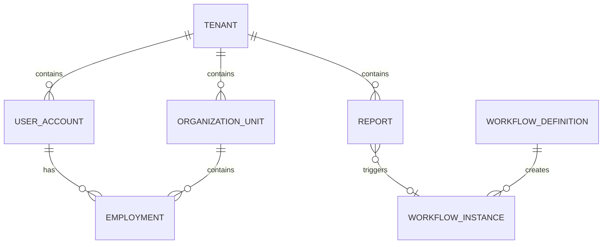

# データベース基本設計書

- 設計ID: SYS-BD-004

## 1. 目的
Cloudflare D1（SQLite互換DB）上でテナント分離、監査、UUID、トランザクション、将来拡張を実現する基本方針を定義する。

## 2. 設計方針
- 初期公開先の基本データストアはCloudflare D1とする。
- 主キーは原則UUIDとし、D1では標準形式の文字列として保存する。
- SQLite互換性を前提とし、PostgreSQL固有の型・機能には依存しない。
- テナントデータは原則tenant_idを持つ。
- Repository層でtenant_idスコープを必須化し、テナント境界をアプリケーション側で強制する。
- 論理削除・物理削除はテーブル保全要件ごとに詳細設計で決定。
- マイグレーションは追加・後方互換性を考慮。

## 3. 機能概要
共通テーブルとモジュール固有テーブルを分離し、テナント、認証主体、組織、社員、報告、ワークフロー定義・実行、通知、ファイル、監査を保持する。

図は論理関係の暫定例であり、詳細なカーディナリティは機能詳細設計で確定する。

## 4. 処理概要
業務操作は通常トランザクション内でDomain検証、更新、監査イベント生成を実行する。ワークフロー状態遷移は競合制御を考慮し、公開済み定義を直接変更しない。

## 5. データの流れ
APIリクエストのテナントコンテキストがRepositoryへ伝播し、全テナント業務クエリへtenant_idスコープを適用する。監査ログ、通知、ジョブもテナント識別子を保持する。

## 6. 関連テーブル・機能
共通テーブル候補: tenants、users、roles、permissions、role_permissions、attachments、notifications、audit_logs、modules、plan_modules。業務テーブル候補: employees、organization_units、positions、employments、reports、report_templates、workflow_definitions、workflow_nodes、workflow_instances、workflow_tasks、workflow_histories。

テーブルIDは機能詳細設計時にT-*を付与する。

## 7. 関連API
保護APIはテナントスコープのリソースと業務操作へ対応付ける。一覧検索、ページネーション、ソート、ロック競合はA-*詳細で定義する。

## 8. セキュリティ考慮事項
- tenant_idスコープ漏れ防止
- D1のDBレベルRow-Level Securityには依存せず、サーバー側のRepositoryでテナント境界を強制する。
- 個人情報暗号化方式の要検討
- 添付ファイルメタデータと実体分離
- 監査ログ改変検知と閲覧制御

## 9. 将来拡張への考慮
モジュール固有テーブルを分離し、共通基盤の主キー・テナント・監査列を一貫させる。D1以外のDBへ移行する場合の型・SQL・マイグレーション差異はDBアダプターと詳細設計で扱う。

## 10. 未決定事項
- UUID生成方式（アプリケーション生成を含め詳細設計で決定）
- D1のアクセスライブラリ、スキーマ管理・マイグレーション方式
- Cloudflare以外の実行環境で利用するDBとアダプター
- D1のバックアップ、エクスポート、復元手順
- 個人情報暗号化方式
- 論理削除対象テーブル
