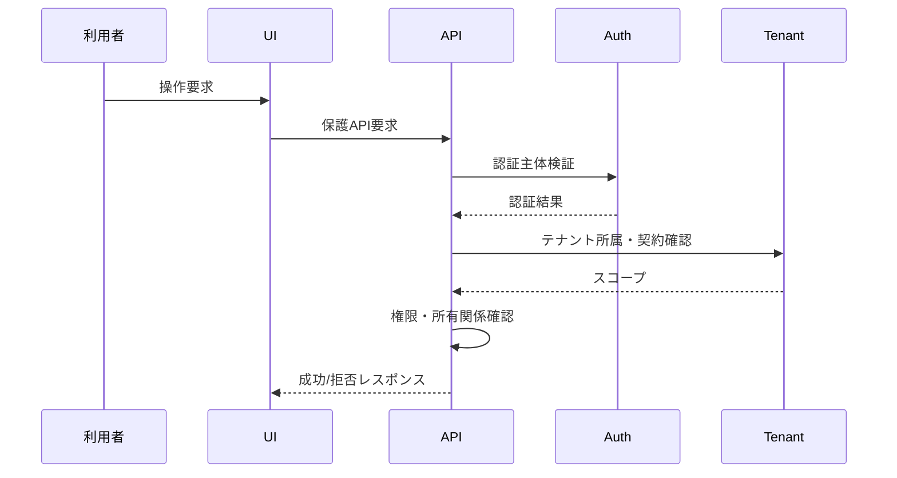

# 認証・認可設計書

- 設計ID: SYS-BD-005

## 1. 目的
利用者を安全に識別し、テナント内でリソースへのアクセスを最小権限で制御する。

## 2. 設計方針
認証と認可を分離する。認証方式は詳細設計まで未確定とし、セッション方式またはトークン方式から選定する。認可はロール・権限・リソース所有関係・テナント所属を組み合わせる。

## 3. 機能概要
- ログイン・ログアウト・セッション失効
- テナント所属の検証
- ロール・権限管理
- リソース単位のアクセス判定
- 管理者による権限付与
- 将来の外部認証連携

## 4. 処理概要
保護APIは認証主体、テナントコンテキスト、権限キー、リソース所有関係をサーバー側で検証する。画面制御は補助であり、APIを通過するすべての操作で権限を再検証する。

## 5. データの流れ
認証主体はテナント所属とロールへ関連付け、認可判定に利用する。認証失敗、権限拒否、テナント境界違反は監査区分に従い記録する。

## 6. 関連モジュール・テーブル・API
- Core/Auth、Core/Permission、Core/Tenant
- テーブル候補: users、tenant_memberships、roles、permissions、role_permissions、sessions/tokens
- 保護API全体が対象。ログイン・ロール管理・権限判定APIはA-ID付与が必要。

## 7. セキュリティ考慮事項
- デフォルト拒否
- パスワードまたはトークン保護
- セッション固定・リプレイ対策
- ブルートフォース対策は要検討
- MFAは将来検討
- CSRF対策は採用方式に応じて実装

## 8. 将来拡張への考慮
SAML/OIDC等の外部認証はアダプター化し、認証方式変更時もApplication ServiceとUIの権限判定を維持する。

## 9. 未決定事項
- セッション方式/トークン方式
- JWT採用可否
- MFA要否
- 外部IdP対応範囲
- パスワードポリシー
