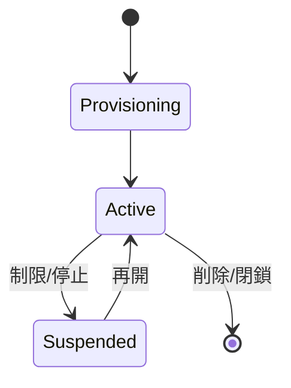

# テナント管理設計書

- 設計ID: SYS-BD-006

## 1. 目的
複数企業データの分離、テナントライフサイクル、契約モジュール制御を統一的に管理する。

## 2. 設計方針
テナントを共通のスコープ単位とし、主要業務データにtenant_idを付与する。テナント識別方法は未確定。テナント間の参照は明示的な管理権限と監査を必要とする。

## 3. 機能概要
テナント作成、停止、再開、契約プラン設定、モジュール有効化、所属ユーザー管理、テナント設定管理を提供する。

## 4. 処理概要
リクエストからテナントを特定し、所属・契約・モジュール有効性を確認してスコープを確定する。バックグラウンドジョブ、通知、ファイル、監査にもテナントコンテキストを伝播する。

## 5. データの流れ
テナント情報からユーザー所属、ロール、契約モジュール、業務データへスコープする。管理APIを除き、テナント間のデータ参照を許可しない。

## 6. 関連モジュール・テーブル・API
- Core/Tenant、Core/Contract、Core/ModuleRegistry
- T-TENANT、T-TENANT_MEMBER、T-CONTRACT_PLAN、T-MODULE_REGISTRATION（候補、詳細で確定）
- テナント管理API、契約プランAPI、モジュール有効化API（A-ID未確定）

## 7. セキュリティ考慮事項
テナント切替に検証を必須とし、所属外テナントへのスコープ変更を拒否する。管理者操作は監査、二段階承認の要否は要検討。バックアップ・移行時にもテナント識別を保持する。

## 8. 将来拡張への考慮
契約プランの段階的変更、モジュール追加、テナント別設定、将来的なデータ分離方式変更に対応できる設計とする。

## 9. 未決定事項
- サブドメイン・パス・ヘッダー等のテナント識別方式
- テナント停止時のデータ保持期間
- プラン課金連携
- テナント間管理者機能の要否
