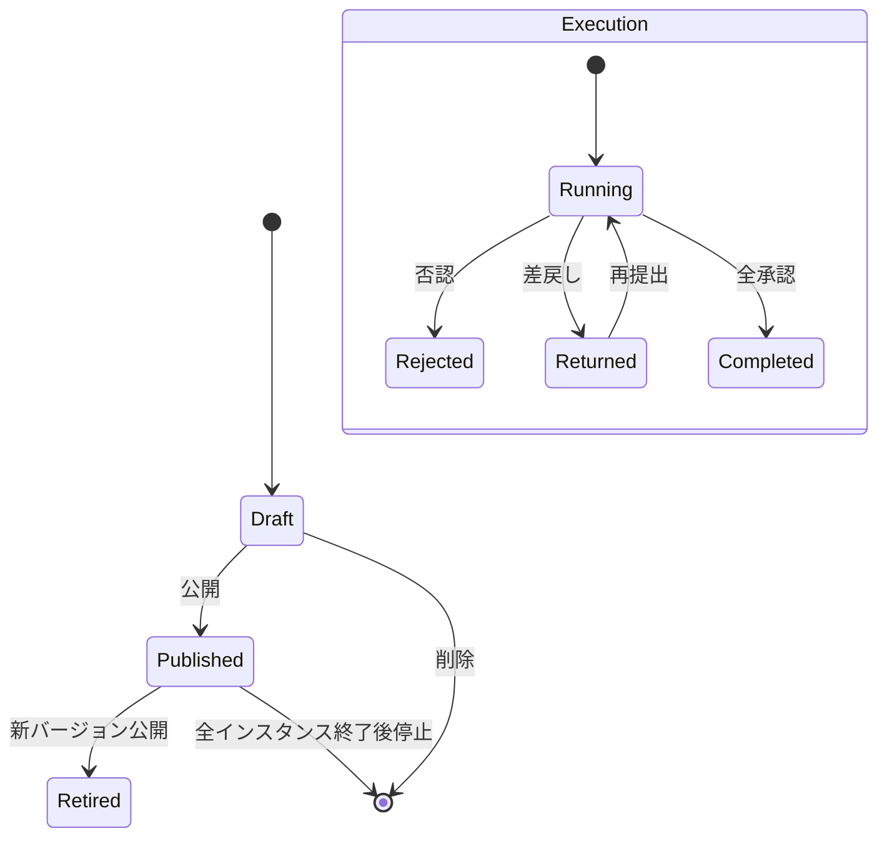

# ワークフロー基本設計書

- 設計ID: SYS-BD-007

## 1. 目的
報告を含む多様な業務に再利用可能な承認フローを、管理者が画面上で定義・実行できる共通基盤として提供する。

## 2. 設計方針
- ワークフローは報告モジュールから独立したCore業務基盤とする。
- 公開済み定義は直接変更せず、新バージョンを作成する。
- ノード、接続、条件、承認者、並列処理、期限、リマインドをメタデータで表現。
- 初期段階では汎用的な承認・確認・分岐・並列・差戻しを対象とする。

## 3. 機能概要
定義管理、ノード追加削除、接続、承認者指定、部署・役職・直属上司指定、条件分岐、並列承認、確認、承認、否認、差戻し、再提出、代理承認、期限、リマインド、履歴、バージョンを扱う。

## 4. 処理概要
公開定義からインスタンスを生成し、ノードごとにタスクを作成する。承認者解決は部署、役職、直属上司、固定ユーザー、代理設定を参照し、条件分岐後に次ノードへ遷移する。複数承認者は並列または順次方式をノード設定で制御する。

## 5. データの流れ
対象リソース（Report等）はworkflow_instanceへ業務種別・業務ID・tenant_idで関連付ける。実行中の定義スナップショットまたは不変バージョンを参照し、履歴へ各遷移を記録する。

## 6. 関連モジュール・テーブル・API
- Modules: Workflow、Report、Organization、Employee、Notification
- テーブル候補: workflow_definitions、workflow_versions、workflow_nodes、workflow_edges、workflow_instances、workflow_tasks、workflow_assignments、workflow_histories
- API候補: 定義、公開、インスタンス、承認、否認、差戻し、再提出、履歴（A-IDは詳細設計で付与）

## 7. セキュリティ考慮事項
タスク実行者のみ承認操作可能とし、代理承認者、有効期限、テナント、状態、業務リソース所有関係を検証する。公開定義の変更権限と実行権限を分離する。履歴を改変不可に近い形式で保全する。

## 8. 将来拡張への考慮
休暇申請、購入申請、経費申請へ汎用公開インターフェースを提供する。外部承認・AI判断は将来ノード種別として追加可能な抽象化とする。

## 9. 未決定事項
- 並列承認の全員／一人／多数決ルールの標準
- 差戻し先ノードの既定挙動
- 期限切れ時の自動処理
- 同時実行競合制御方式
- フロー定義グラフの永続形式
