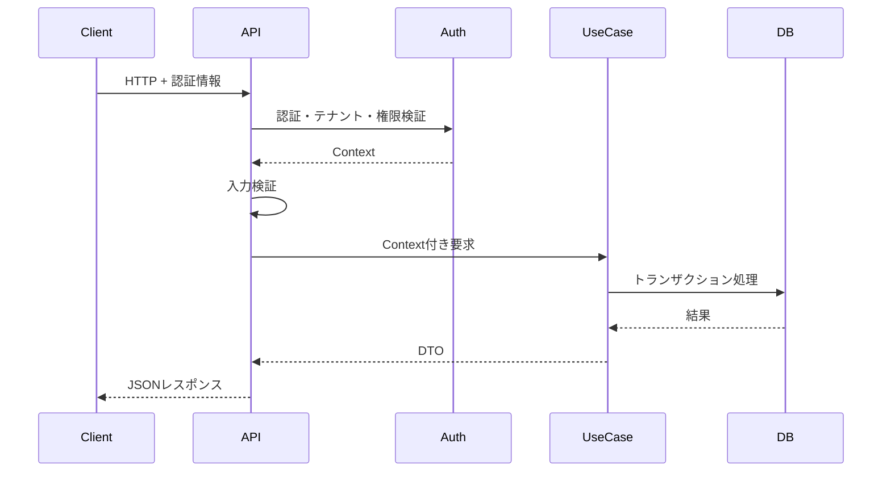

# API基本設計書

- 設計ID: SYS-BD-008

## 1. 目的
REST APIの共通規約、認証、エラー、テナント・権限境界を統一する。

## 2. 設計方針
- 接頭辞 `/api/v1` を使用。
- リソース名は複数形。
- 状態遷移はサブリソースまたは状態遷移リソースを優先。
- JSONレスポンスを基本とする。
- 安定したエラーコードと相関IDを返す。
- 内部データ構造をそのまま返さない。

## 3. 機能概要
認証、テナント特定、権限、入力検証、業務ユースケース、ページネーション、ソート、検索、添付、状態遷移、監査イベントを共通化する。

## 4. 処理概要
Cloudflare WorkerのRoute Handlerは入力受付とレスポンス変換、Application Serviceはユースケース、Domainは業務ルールを実行する。共通処理で認証、テナント、相関ID、エラー形式を扱う。Workers固有のAPIや環境バインディングはInfrastructureに閉じ込める。

## 5. 共通レスポンス方針
- 成功: `data`、必要に応じ`meta`。
- 検証エラー: 安定コード、フィールド別エラー。
- 業務拒否: 安定コード、安全な利用者メッセージ。
- システム障害: 相関ID付き安全なメッセージ。

## 6. 関連テーブル・モジュール
すべての保護APIはtenant_idスコープを利用し、認証、テナント、権限テーブルへ依存する。各APIはF-*、A-*、T-*へトレースする。

## 7. セキュリティ考慮事項
保護APIでは認証・テナント・権限・検証を必須とする。レート制限、CORS、CSRF、サイズ制限、アップロード形式、時限URL、機密ログ除外を方式確定後に詳細設計する。

## 8. 将来拡張への考慮
モジュールごとのルート登録、バージョン互換性、非同期ジョブ、Webhook、GraphQL導入は暫定的に非採用とし、RESTで段階的に拡張する。

## 9. 未決定事項
- ページネーション形式（カーソル／オフセット）
- 共通エラーコード体系の完全一覧
- レート制限方式
- API認証方式
- Workers APIのルーティング／ミドルウェア方式
- Webhook・非同期ジョブAPI方式
