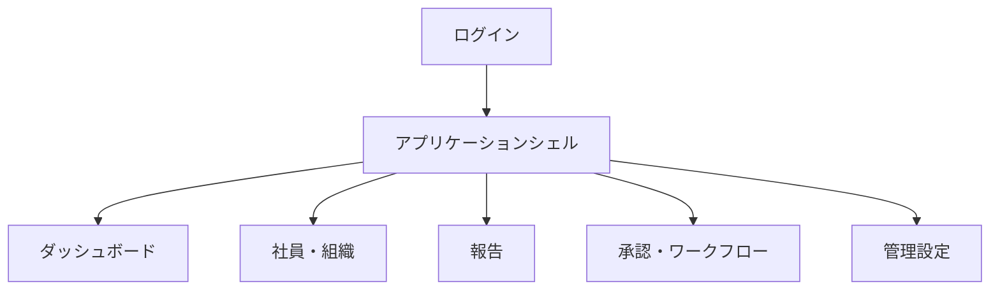

# 画面基本設計書

- 設計ID: SYS-BD-009

## 1. 目的
共通レイアウト、画面状態、権限表示、業務モジュール拡張を統一する。

## 2. 設計方針
Vue.jsでSPA構成を基本とし、Core共通UIと業務モジュールUIを分離する。画面制御は補助とし、サーバー権限を最終境界とする。レスポンシブ対応方針は要検討。

## 3. 機能概要
ログイン、テナント切替候補、ダッシュボード、社員・組織、報告、承認、通知、ファイル、管理画面を共通ナビゲーションから利用する。

## 4. 処理概要
画面はAPIクライアント経由でデータ取得、入力検証、業務操作を行う。共通シェルは認証状態、テナント、権限、通知、エラー表示、ローディングを管理する。

## 5. データの流れ
認証主体とテナント情報はフロントエンドセッション/ストアへ保持し、API要求に伝播する。個人情報やトークンを不必要にブラウザログへ出力しない。

## 6. 関連画面・モジュール
画面IDはUI-*を付与する。関連モジュール: Core、Employee、Organization、Report、Workflow。

## 7. セキュリティ考慮事項
権限のない操作は表示制御とサーバー拒否の両方で扱う。XSS対策としてテンプレートエスケープと安全なレンダリングを基本とし、ファイルプレビューは安全なURLを使用する。

## 8. 将来拡張への考慮
モジュールレジストリからナビゲーション、ルート、契約可否を取得し、将来モジュールの追加を容易にする。画面設計システムの導入有無は要検討。

## 9. 未決定事項
- SPAのルーティング方式と認証方式との整合
- デザインシステム／UIライブラリ
- モバイル対応範囲
- ブラウザ・アクセシビリティ対応要件
