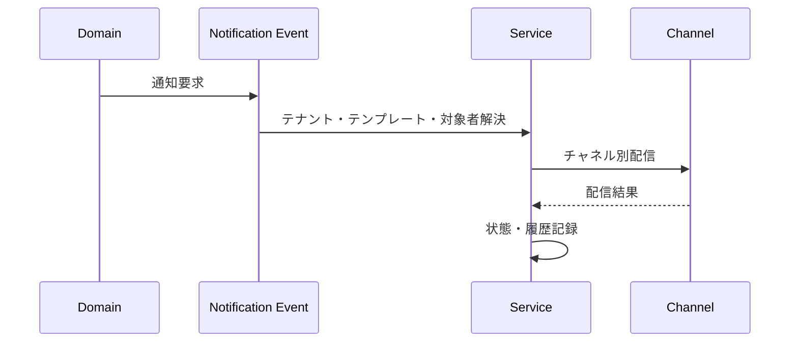

# 通知機能設計書

- 設計ID: SYS-BD-010

## 1. 目的
承認期限、差戻し、報告提出、リマインド等をテナント情報と対象者に基づいて統一的に配信する。

## 2. 設計方針
通知をドメインイベントから生成する共通基盤とし、送信チャネルはアダプター化する。初期チャネルは要検討だが、アプリ内通知を基本候補とする。

## 3. 機能概要
通知一覧、既読、配信設定、承認リマインド、期限通知、差戻し通知、再提出通知、将来のメール・チャット連携を扱う。

## 4. 処理概要
業務操作後にNotificationRequestedイベントを発行し、通知テンプレート、対象者、テナント設定、配信チャネルを解決する。再送・重複防止・配信失敗は詳細設計で定義する。

## 5. データの流れ
通知はtenant_id、受信者、種別、テンプレート、関連リソース、状態、送信日時を保持する。配信失敗情報は秘密情報を含めず運用可能な相関IDで記録する。

## 6. 関連モジュール・テーブル・API
- Core/Notification、Workflow、Report
- テーブル候補: notifications、notification_templates、notification_preferences、notification_deliveries
- API候補: 一覧、既読、設定（A-ID詳細確定）

## 7. セキュリティ考慮事項
テナント外通知を禁止し、受信者の所属・権限を配信時に再確認する。外部送信には最小限の情報のみを含める。通知URLには認証または時限トークンを使用する。

## 8. 将来拡張への考慮
メール、プッシュ、チャット、Webhookはアダプターとして追加する。多言語テンプレート、集約通知、配信時間帯制御を将来拡張可能にする。

## 9. 未決定事項
- 初期配信チャネル
- メール送信基盤
- リマインド間隔・最大回数
- 通知保持期間
- 非同期キュー方式
