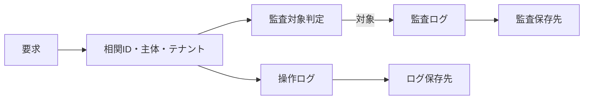

# ログ・監査設計書

- 設計ID: SYS-BD-011

## 1. 目的
障害調査、利用操作の追跡、監査証跡を区別して安全に管理する。

## 2. 設計方針
- 操作ログと監査ログを区別。
- 相関IDをリクエスト・ジョブ・外部連携へ伝播。
- 個人情報、添付内容、秘密情報を通常ログへ出力しない。
- 監査ログはテナント、主体、操作、対象、時刻、相関ID、結果を保持。

## 3. 機能概要
通常ログは障害調査に使用し、監査ログは権限変更、テナント設定、承認操作、定義公開、ファイルアクセス等を証跡として記録する。

## 4. 処理概要
共通ミドルウェアで主体・テナント・相関IDをコンテキストへ設定し、アプリケーション層で監査対象操作を記録する。認証失敗、権限拒否、検証失敗、業務拒否、システム障害を区別する。

## 5. データの流れ
監査イベントは業務トランザクションと整合性の要否を機能ごとに判断し、失敗時の再送・整合性検証を詳細設計で定義する。ログはテナント単位の閲覧制御を検討する。

## 6. 関連テーブル・モジュール
- Core/Audit、全業務モジュール
- テーブル候補: audit_logs、audit_events、correlation_requests、security_events
- ログ保存先は環境アダプターで切替。

## 7. セキュリティ考慮事項
監査ログ改変検知、保持期間、閲覧権限、エクスポート制御、個人情報マスキング、秘密情報除外を行う。ログイン失敗、権限拒否、管理操作は優先監査対象とする。

## 8. 将来拡張への考慮
SIEM連携、監査レポート、長期アーカイブ、外部証跡連携をアダプターで追加できる構成とする。

## 9. 未決定事項
- ログ基盤（ファイル・クラウド・サービス）
- 保持期間
- 監査ログ改変検知方式
- 個人情報マスキング方式
- セキュリティ監視連携方式
