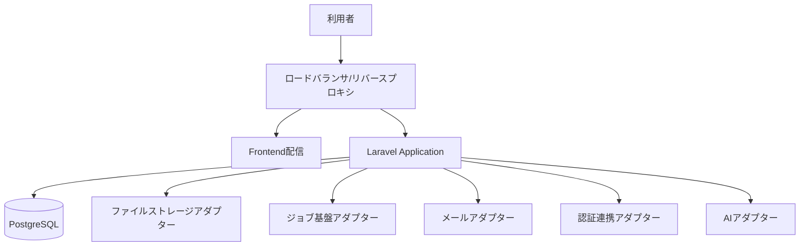

# クラウド・オンプレミス構成設計書

- 設計ID: SYS-BD-012

## 1. 目的
クラウド、オンプレミス双方で運用可能な構成を、環境依存処理の分離により提供する。

## 2. 設計方針
モジュラモノリスを基準とし、コンテナ利用可否は要検討。ファイル、メール、認証連携、AI、ジョブ、シークレットはアダプターまたは設定で切替可能にする。

## 3. 機能概要
Frontend配信、Laravel Backend、PostgreSQL、ファイルストレージ、バックグラウンドジョブ、メール、監視、バックアップを環境単位で構成する。

## 4. 処理概要
環境設定により接続先、ストレージ、メール、認証、ジョブ、ログ保存先を選択する。デプロイはアプリケーション本体とデータ移行を分離し、ロールバック手順を運用設計で定義する。

## 5. データの流れ
業務データはDBへ保存し、添付はストレージへ保存する。テナント識別とファイルパスの対応をアプリケーションで管理し、直接参照を許可しない。バックアップはテナント境界、復元手順を考慮する。

## 6. 関連モジュール・テーブル
全モジュール、Infrastructureアダプター、テナント、監査、ファイルテーブルが対象。

## 7. セキュリティ考慮事項
TLS、秘密情報、ネットワーク分離、最小権限、脆弱性管理、バックアップ暗号化、アップデート手順を環境要件へ含める。クラウド固有サービスへ業務ロジックを固定しない。

## 8. 将来拡張への考慮
複数クラウド、ハイブリッド運用、将来的なAI連携、外部IdP、オブジェクトストレージへアダプターを追加できる構成とする。

## 9. 未決定事項
- Docker利用可否
- クラウド事業者
- オンプレミス要件
- PostgreSQL運用方式
- ロードバランサ・リバースプロキシ製品
- バックアップ・監視・SIEM製品
