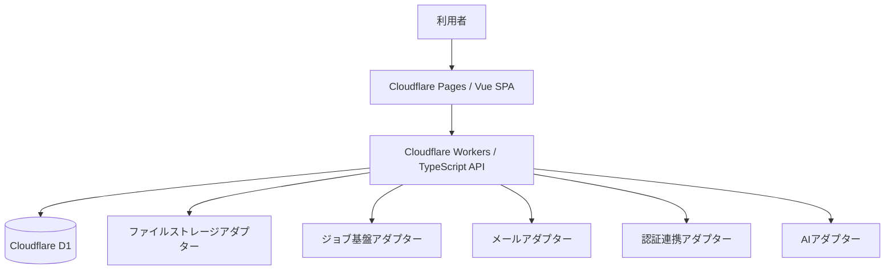

# クラウド・オンプレミス構成設計書

- 設計ID: SYS-BD-012

## 1. 目的
Cloudflare無料枠での初期公開構成を定義し、環境依存処理を分離する。クラウド・オンプレミス双方への対応方針は維持するが、Cloudflare以外の実行環境とDB構成は未決定とする。

## 2. 設計方針
初期公開先はCloudflare Pages（Frontend静的配信）、Cloudflare Workers（TypeScript API）、Cloudflare D1（SQLite互換DB）とする。APIは単一Workerのモジュラモノリスとし、ファイル、メール、認証連携、AI、ジョブ、シークレットはアダプターまたは設定で分離する。オンプレミス対応は別途実行環境・DBアダプターの設計を要する。

## 3. 機能概要
初期公開構成ではFrontendをPages、APIをWorkers、業務データをD1で扱う。ファイルストレージ、バックグラウンドジョブ、メール、認証連携、監視、バックアップの具体的な製品・方式は未決定とする。

## 4. 処理概要
FrontendとAPIをCloudflareへデプロイし、D1のスキーマ変更はアプリケーションのリリースと管理する。Workersは常駐サーバーではなくリクエスト単位で実行されるため、プロセス内状態に依存しない。デプロイ、DB移行、ロールバック手順は運用設計で定義する。

## 5. データの流れ
業務データはDBへ保存し、添付はストレージへ保存する。テナント識別とファイルパスの対応をアプリケーションで管理し、直接参照を許可しない。バックアップはテナント境界、復元手順を考慮する。

## 6. 関連モジュール・テーブル
全モジュール、Infrastructureアダプター、テナント、監査、ファイルテーブルが対象。

## 7. セキュリティ考慮事項
TLS、秘密情報、ネットワーク分離、最小権限、脆弱性管理、バックアップ暗号化、アップデート手順を環境要件へ含める。クラウド固有サービスへ業務ロジックを固定しない。

## 8. 将来拡張への考慮
複数クラウド、オンプレミス、将来的なAI連携、外部IdP、オブジェクトストレージへアダプターを追加できる構成を目指す。D1固有のSQL・型・運用機能を業務ロジックに露出させない。

## 9. 未決定事項
- TypeScript、Vue.js、Workers互換性の具体バージョン
- Workers APIのフレームワーク、デプロイ・マイグレーション手順
- オンプレミス対応に必要な実行環境・DBアダプター
- ファイル、メール、認証、ジョブ、AIの各アダプター
- D1のバックアップ・復元、監視、監査ログの運用方式
- Cloudflare無料枠の上限超過時の通知・停止・有料化判断

## 10. 無料枠の前提
Cloudflareの無料枠は変更される可能性があるため、公開前に最新の制限と利用規約を確認する。現行の公式資料ではWorkersは1日あたり10万リクエスト、1リクエストあたりCPU時間10ms、D1は1日あたり500万行読み取り・10万行書き込み、アカウント合計5GB、10データベースが上限として記載されている。Pagesの静的アセット配信は無料・無制限だが、Functionsを利用する要求はWorkersの上限に含まれる。

- [Workers料金・制限](https://developers.cloudflare.com/workers/platform/pricing/)
- [Pages Functions料金](https://developers.cloudflare.com/pages/functions/pricing/)
- [D1料金・制限](https://developers.cloudflare.com/d1/platform/pricing/)
