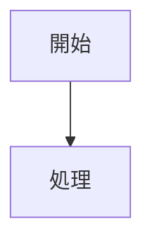

# 詳細設計テンプレート

- 設計ID:
- 設計対象:
- 機能ID:
- 対応する基本設計ID:
- 作成日:
- 状態: 未着手／作成中／レビュー待ち／確定

## 1. 目的

## 2. 処理概要

## 3. 入力項目

|項目名|型|必須|制約|説明|
|---|---|---|---|---|

## 4. 出力項目

## 5. バリデーション

## 6. 処理フロー

## 7. DBアクセス

- テーブルID:
- アクセス種別:
- トランザクション:
- テナント境界:

## 8. API連携

- API ID:
- メソッド:
- エンドポイント:

## 9. エラー処理

|条件|エラーコード|HTTPステータス|利用者メッセージ|ログ|
|---|---|---|---|---|

## 10. 権限チェック

## 11. トランザクション制御

## 12. ログ出力

## 13. テスト観点

- 正常系:
- 異常系:
- 権限:
- テナント分離:
- 状態遷移:
- 性能:

## 14. 関連設計書

- 基本設計:
- DB設計:
- API設計:
- UI設計:
- テスト設計:

## 15. 未決定事項
